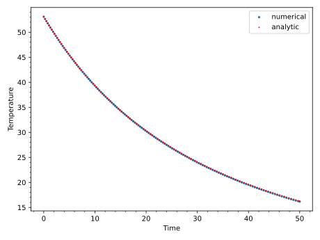
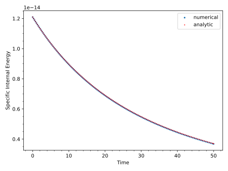
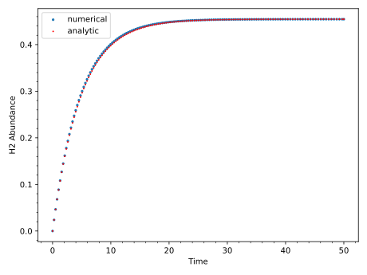
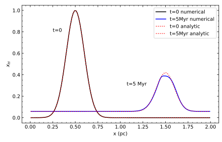

**If you use this chemistry module in your publication, please cite the accompanying code paper [Gong et al. (2023)](https://ui.adsabs.harvard.edu/abs/2023ApJS..268...42G/abstract).**
The paper also provides some more details beyond this documentation.

# Formulation


Chemistry uses the basic functionality of the passive scalars included in the `hydro` or `mhd` modules. The reaction rates act as a source term for the passive scalars. It can also interact with other parts of the code, e.g. heating and cooling rates in the energy equation, the mean molecular weight, opacity in radiation transfer, etc.

# Solving Chemistry

Because the chemical reaction rates for different species often differ by orders of magnitude, implicit solvers are better suited to solve the rate equations. We use the operator split method: after the `hydro`/`mhd` solver has finished, we advance the chemical abundances and the internal energy for the hydrodynamic time step dt, by solving a set of coupled ODEs of chemical rate equations and heating/cooling implicitly:

$$\frac{\mathrm{d} x_s}{\mathrm{d} t} = \mathcal{C}_s$$

$$\frac{\mathrm{d} e}{\mathrm{d} t} = n(\Gamma - \Lambda)$$

In the code, the reaction rate $\mathcal{C}_s$ and the $\frac{de}{dt}$ (heating and cooling) are computed in the `evaluate_function` method of the various chemistry network classes. Because the chemical reaction rate $\mathcal{C}_s$ usually depends on the temperature `T`, the user often need to have some expression of `T` as a function of the internal energy `e` in their RHS. Currently, chemistry works with a adiabatic equation of state with a fixed adiabatic index set by the `gamma` parameter in the `hydro` or `mhd` modules. General EOS dependence on chemistry has not been included yet.

Note that the passive scalar advection (and diffusion) is solved separately prior to the chemical rate equations. This operator split method is only first-order accurate. The forced conservation of elemental abundances (such as by rescaling the flux of different species) has not been implemented yet. Relatively small errors are usually found for elemental conservation from ODE solvers.

# Running the Code

## Input File

To run with chemistry you need to include the `<chemistry>` block in the input file. Within that you have the following parameters

| Option                 | Type   | Allowed Values            | Default              | Description                                                                                                                                 |
| ---------------------- | ------ | ------------------------- | -------------------- | ------------------------------------------------------------------------------------------------------------------------------------------- |
| network                | string | H2, GOW17                 | None, mandatory flag | The chemistry network to use. These networks often have their own runtime parameters which are detailed in their respective sections below. |
| ode_solver             | string | forward_euler, kokkos_BDF | None, mandatory flag | The ODE solver to use. See the [ODE Solvers](ODE-Solvers) page for which solvers are available and any runtime parameters they may have.    |
| mu_H                   | Real   | any real > 1              | 1.4                  | The mean molecular mass per hydrogen nucleon                                                                                                |

Chemistry also requires that the `<units>` module be enabled. A good default set of units to use for ISM chemistry is:

```
<units> 
# ISM units
length_cgs  = 3.0856775809623245e+18  # length is 1 pc
mass_cgs    = 6.195900228622575e+31   # number density is 1 cm^-3
time_cgs    = 3.15576e+13             # time is 1 Myr
mu          = 1.4                     # mean molecular weight
```

# Chemistry

## Passive Scalars

The chemical species uses the passive scalar structure in the code. By default, the number of species is the number of scalars. If the user wants additional passive scalars to be added (for example, tracer scalars that is not involved in chemical reactions), the number of scalars can be set separately in the `nscalars` parameter.

## Existing Chemical Networks

### H2

This is a 2-species HI-H2 network. Although this network is very simplified and does not represent the realistic HI-H2 transition in the ISM, it has the advantage of having an analytic solution when $C_v$ is constant, and is used in tests.

Runtime parameters for the H2 network, these go inside the `<chemistry>` block:

| Option                 | Type   | Allowed Values | Default       | Description                                                                                    |
| ---------------------- | ------ | -------------- | ------------- | ---------------------------------------------------------------------------------------------- |
| h2_constant_cv         | bool   | true, false    | false         | Whether or not $C_v$ should be constant. If true then $C_v$ is set to $1.1 K_b / (\gamma - 1)$ |
| h2_isothermal          | bool   | true, false    | false         | If the H2 network should use an isothermal EOS, i.e. set the change in internal energy to zero |

### GOW17

The GOW17 network is from the work of [Gong, Ostriker and Wolfire (2017)](https://ui.adsabs.harvard.edu/abs/2017ApJ...843...38G/abstract). It is a widely used and well-tested network for carbon and oxygen chemistry in the atomic and molecular ISM. It has the advantage of being relatively simple, with only 18 species and about 50 reactions, while still accurately capturing the most important chemical and thermal processes compared to more sophisticated networks.

Of the 18 species, 12 are evolved directly by the ODE solver (He+, OHx, CHx, CO, C+, HCO+, H2, H+, H3+, H2+, O+, and Si+) while the remaining "ghost" species (Si, C, O, He, e-, and H) are recomputed algebraically from the conservation laws on every function evaluation. The internal energy is evolved alongside the species for a total of 13 equations. Because the reaction rates span many orders of magnitude the network is stiff, so an implicit ODE solver such as [Kokkos BDF](ODE-Solvers#kokkos-bdf) is recommended and the Forward Euler solver is known not to converge in a reasonable amount of time.

The GOW17 network uses 8 radiation bands: 6 photodissociation and photoionization bands, 1 band for photoelectric heating and grain-assisted recombination, and a final band that holds the cosmic-ray ionization rate. See [Radiation](#radiation) for how these are set.

Runtime parameters for the GOW17 network, these go inside the `<chemistry>` block:

| Option                           | Type | Allowed Values         | Default                 | Description                                                                                                                    |
| -------------------------------- | ---- | ---------------------- | ----------------------- | -------------------------------------------------------------------------------------------------------------------------------|
| GOW17_Z_d                        | Real | any real $\geq$ 0      | 1.0                     | Dust metallicity relative to solar                                                                                             |
| GOW17_Z_g                        | Real | any real $\geq$ 0      | 1.0                     | Gas-phase metallicity relative to solar. Scales the `GOW17_xC`, `GOW17_xO`, and `GOW17_xSi` abundances                         |
| GOW17_xHe                        | Real | any real $\geq$ 0      | 0.1                     | Helium abundance per hydrogen nucleon                                                                                          |
| GOW17_xC                         | Real | any real $\geq$ 0      | 1.6e-4                  | Carbon abundance per hydrogen nucleon at $Z=1$ (multiplied by `GOW17_Z_g`)                                                     |
| GOW17_xO                         | Real | any real $\geq$ 0      | 3.2e-4                  | Oxygen abundance per hydrogen nucleon at $Z=1$ (multiplied by `GOW17_Z_g`)                                                     |
| GOW17_xSi                        | Real | any real $\geq$ 0      | 1.7e-6                  | Silicon abundance per hydrogen nucleon at $Z=1$ (multiplied by `GOW17_Z_g`)                                                    |
| GOW17_isothermal                 | bool | true, false            | false                   | Turn off heating and cooling and use a fixed temperature, $T = c_s^2 \mu_\mathrm{iso} m_\mathrm{H} / k_B$, for the reaction rates. The hydro EOS is unchanged, so with an ideal EOS the internal energy is still evolved by the hydro. If true, `GOW17_mu_iso` and `hydro/iso_sound_speed` must also be set |
| GOW17_mu_iso                     | Real | any real > 0           | mandatory if isothermal | Mean molecular weight used to convert `hydro/iso_sound_speed` into the fixed temperature                                       |
| GOW17_temperature_min_rates      | Real | any real > 0           | 1.0                     | Minimum temperature (K) for the reaction rates; also applied as a temperature floor in the energy equation                     |
| GOW17_temperature_max_rates      | Real | any real > 0           | $\infty$                | Maximum temperature (K) for the reaction rates. Does not apply to collisional dissociation reactions or the energy equation    |
| GOW17_temperature_max_heating    | Real | any real > 0           | $\infty$                | Temperature (K) above which heating is turned off                                                                              |
| GOW17_temperature_min_cooling    | Real | any real > 0           | 1.0                     | Temperature (K) below which cooling is turned off                                                                              |
| GOW17_temperature_max_cooling_nm | Real | any real > 0           | 1.0e9                   | Temperature (K) at which cooling for the neutral medium is capped                                                              |
| GOW17_Leff_CO_max                | Real | any real > 0           | 3.0e20                  | Maximum effective length (cm) for CO cooling                                                                                   |
| GOW17_H2_rovib_cooling           | bool | true, false            | true                    | Whether to include H2 rovibrational cooling                                                                                    |
| is_kgrH2_const                   | bool | true, false            | false                   | Whether to use a constant H2 formation rate on grains                                                                          |

## Radiation

Chemistry can depend on the radiation field, for example through photodissociation, photoionization, and photoelectric heating. The radiation method is selected at runtime with the `radiation_integrator` parameter in the `<chemistry>` block. Other radiation modules in AthenaK, such as the `<radiation>` transport module, are not coupled to chemistry at this time.

| Option               | Type   | Allowed Values    | Default  | Description                             |
| -------------------- | ------ | ----------------- | -------- | --------------------------------------- |
| radiation_integrator | string | constant, six_ray | constant | The radiation method used for chemistry |

The radiation field is stored as one value per frequency band. The number and meaning of the bands depend on the chemistry network; see the network sections above.

### Constant Radiation

The radiation field is uniform in space and constant in time. This is the simplest option. It is useful for testing and as a template for writing your own radiation method.

Runtime parameters for constant radiation, these go inside the `<chemistry>` block:

| Option       | Type | Allowed Values    | Default | Description                                                                                                    |
| ------------ | ---- | ----------------- | ------- | -------------------------------------------------------------------------------------------------------------- |
| radiation_G0 | Real | any real $\geq$ 0 | 0       | Strength of the interstellar radiation field relative to the Draine (1978) field, applied to every photon band |
| radiation_CR | Real | any real $\geq$ 0 | 2e-16   | Cosmic-ray ionization rate per hydrogen nucleon in s$^{-1}$                                                    |

### Six-ray

The six-ray method computes the radiation field by ray tracing along the six Cartesian directions ($\pm x$, $\pm y$, $\pm z$) and averaging the attenuated field over those directions. The incident radiation is assumed to come from the edge of the computational domain along each ray, and it can be set separately for each direction. Because the incident field is assumed to come from the physical boundary, it is compatible with periodic, outflow, reflecting, and user-defined boundary conditions.

#### Column densities

For every cell, the column densities of H nuclei ($N_\mathrm{H}$), H2 ($N_\mathrm{H_2}$), CO ($N_\mathrm{CO}$), and neutral carbon ($N_\mathrm{C}$) are summed along each of the six rays, from the domain boundary the ray enters through up to the cell. The cell's own column is included with weight `shielding_fraction_cell`, 0.5 by default, so each cell is shielded by half of itself. The neutral carbon abundance comes from carbon conservation, $x_\mathrm{C} = x_\mathrm{C,tot} - x_\mathrm{HCO^+} - x_\mathrm{CH_x} - x_\mathrm{CO} - x_\mathrm{C^+}$, floored at zero. Column densities are converted to cm$^{-2}$ with the `<units>` module and `mu_H`.

The six sums are computed concurrently with the `LineScan` utility, which handles MPI decomposition and static and adaptive mesh refinement. The columns are recomputed once per timestep at the beginning of the chemistry stage.

#### Shielded radiation field

Each ray $i$ starts with the incident field $G_{0,i}$ of the boundary it enters through. Along the ray:

- The dust extinction is $A_V = N_\mathrm{H} Z_d / 1.87\times10^{21}\ \mathrm{cm^{-2}}$, where $Z_d$ is `GOW17_Z_d`.
- Each photodissociation and photoionization band $f$ is attenuated by dust, $G_{0,i}\, e^{-\gamma_f A_V}$, with $\gamma_f$ = 3.76 (C), 2.12 (CHx), 3.88 (CO), 2.66 (OHx), 4.18 (H2), and 2.61 (Si).
- The H2, CO, and C bands are additionally multiplied by self-shielding factors:
  - H2 self-shielding, from [Draine & Bertoldi (1996)](https://ui.adsabs.harvard.edu/abs/1996ApJ...468..269D/abstract) equation (37), with a Doppler parameter of 3 km/s.
  - CO self-shielding and shielding by H2, from the tables of [Visser, van Dishoeck & Black (2009)](https://ui.adsabs.harvard.edu/abs/2009A%26A...503..323V/abstract).
  - Neutral carbon self-shielding and shielding by H2, from [Tielens & Hollenbach (1985)](https://ui.adsabs.harvard.edu/abs/1985ApJ...291..722T/abstract).
- The photoelectric heating band is attenuated as $G_{0,i}\, e^{-N_\mathrm{H} \sigma_\mathrm{PE} Z_d}$ with $\sigma_\mathrm{PE} = 10^{-21}\ \mathrm{cm^2}$.
- The cosmic-ray band is `radiation_CR`. If `radiation_CR_shielding` is true, it is reduced to `radiation_CR` $\times\, N_0 / N_\mathrm{H}$ where $N_\mathrm{H} > N_0 = 9.35\times10^{20}\ \mathrm{cm^{-2}}$.

The field the network sees in each band is the average over all six rays, i.e. the sum divided by six. Rays with no incident field still count in the average, so a slab lit from a single face sees at most $G_0/6$.

Runtime parameters for six-ray radiation, these go inside the `<chemistry>` block:

| Option                  | Type | Allowed Values         | Default        | Description                                                                                                                       |
| ----------------------- | ---- | ---------------------- | -------------- | --------------------------------------------------------------------------------------------------------------------------------- |
| radiation_G0            | Real | any real $\geq$ 0      | 0              | Incident radiation field relative to the Draine (1978) field, the default for every face                                         |
| radiation_G0_inner_x1   | Real | any real $\geq$ 0      | `radiation_G0` | Incident field of the ray entering through the inner x1 boundary, travelling in $+x$                                              |
| radiation_G0_outer_x1   | Real | any real $\geq$ 0      | `radiation_G0` | Incident field of the ray entering through the outer x1 boundary, travelling in $-x$                                              |
| radiation_G0_inner_x2   | Real | any real $\geq$ 0      | `radiation_G0` | Incident field of the ray entering through the inner x2 boundary, travelling in $+y$                                              |
| radiation_G0_outer_x2   | Real | any real $\geq$ 0      | `radiation_G0` | Incident field of the ray entering through the outer x2 boundary, travelling in $-y$                                              |
| radiation_G0_inner_x3   | Real | any real $\geq$ 0      | `radiation_G0` | Incident field of the ray entering through the inner x3 boundary, travelling in $+z$                                              |
| radiation_G0_outer_x3   | Real | any real $\geq$ 0      | `radiation_G0` | Incident field of the ray entering through the outer x3 boundary, travelling in $-z$                                              |
| radiation_CR            | Real | any real $\geq$ 0      | 2e-16          | Unshielded cosmic-ray ionization rate per hydrogen nucleon in s$^{-1}$                                                            |
| radiation_CR_shielding  | bool | true, false            | false          | Whether to attenuate the cosmic-ray ionization rate above $N_\mathrm{H} = 9.35\times10^{20}\ \mathrm{cm^{-2}}$                  |
| shielding_fraction_cell | Real | 0 to 1                 | 0.5            | Fraction of a cell's own column that shields the cell. 0 excludes the cell itself and 1 includes all of it                         |

## Timestep details

Currently, the overall chemical timestep is the same as the hydro timestep: the ODE solver advances the chemical abundances and energy for a single hydro timestep. Note that the ODE solver uses subcycling internally, and the subcycling timestep is adjusted to ensure the solution converges, but this process is hidden from the user. The overall timestep can be reduced by lowering the CFL number or by setting a maximum timestep with `dt_max` in the `<time>` block, and the ODE solvers generally have runtime options to make them more accurate. `dt_max` is useful when the hydro places little or no limit on the timestep, e.g. kinematic evolution with zero velocity. The six-ray column densities are recomputed once per timestep, so in that case the number of timesteps sets how many times the radiation and chemistry are brought into balance, as in the static PDR test below.

## Test Problems

### H2 Uniform

This test problem has a constant hydrodynamic background and follows the evolution of the H and H2 abundances. It has an analytic solution and details can be found in Section 4.1 of [Gong et al. (2023)](https://ui.adsabs.harvard.edu/abs/2023ApJS..268...42G/abstract).

- Input File: [H2_uniform.athinput](../../blob/main-chemistry/inputs/chemistry/H2_uniform.athinput)
- `pgen_name`: H2_uniform

Problem generator parameters, all are within the `<problem>` block unless otherwise specified:

| Option                 | Type   | Default       | Description                                                                        |
| ---------------------- | ------ | ------------- | ---------------------------------------------------------------------------------- |
| n_H                    | Real   | mandatory     | The number density of hydrogen                                                     |
| hydro/iso_sound_speed  | Real   | mandatory     | The isothermal sound speed defined in the `<hydro>` block                          |
| vx_kms                 | Real   | mandatory     | The x velocity in km/s                                                             |
| init_H                 | Real   | mandatory     | The initial abundance of hydrogen gas                                              |
| init_H2                | Real   | mandatory     | The initial abundance of molecular hydrogen                                        |

#### Time Evolution of the H2 Uniform Test






### H2 Advecting Gaussian

This test problem has a Gaussian profile in H and H2 abundances with a constant velocity in $x$. It has an analytic solution and details can be found in Section 4.1 of [Gong et al. (2023)](https://ui.adsabs.harvard.edu/abs/2023ApJS..268...42G/abstract).

- Input File: [H2_advection.athinput](../../blob/main-chemistry/inputs/chemistry/H2_advection.athinput)
- `pgen_name`: H2_advection

Problem generator parameters, all are within the `<problem>` block unless otherwise specified:

| Option                 | Type   | Default       | Description                                                                        |
| ---------------------- | ------ | ------------- | ---------------------------------------------------------------------------------- |
| n_H                    | Real   | mandatory     | The number density of hydrogen                                                     |
| hydro/iso_sound_speed  | Real   | mandatory     | The isothermal sound speed defined in the `<hydro>` block                          |
| vx_kms                 | Real   | mandatory     | The x velocity in km/s                                                             |
| init_H                 | Real   | 0.0           | The initial abundance of hydrogen gas                                              |
| gaussian_mean          | Real   | 0.5           | The mean of the initial Gaussian profile                                           |
| gaussian_std           | Real   | 0.1           | The standard deviation of the initial Gaussian profile                             |

#### Initial and Final States of the H2 Advection Test Compared to the Analytical Solution with `nx=128`




### GOW17 Uniform

This test problem has a uniform hydrodynamic state and evolves the GOW17 network to chemical and thermal equilibrium. It is used in tests of the GOW17 network, and its problem generator also sets up the static PDR test below. Details can be found in Section 4.1 of [Gong et al. (2023)](https://ui.adsabs.harvard.edu/abs/2023ApJS..268...42G/abstract).

- Input File: [GOW17_uniform.athinput](../../blob/main-chemistry/inputs/chemistry/GOW17_uniform.athinput)
- `pgen_name`: GOW17_uniform

Problem generator parameters, all are within the `<problem>` block unless otherwise specified:

| Option                 | Type   | Default       | Description                                                                                                  |
| ---------------------- | ------ | ------------- | ------------------------------------------------------------------------------------------------------------ |
| n_H                    | Real   | mandatory     | The number density of hydrogen nuclei in cm$^{-3}$                                                           |
| hydro/iso_sound_speed  | Real   | mandatory     | Sets the initial pressure, $n_\mathrm{H} c_s^2$, in code units. It is defined in the `<hydro>` block          |
| vx_kms                 | Real   | 0.0           | The x velocity in km/s                                                                                       |
| init_default           | Real   | 0.0           | The initial abundance of every species not set with `init_<species>`                                          |
| init_<species>         | Real   | init_default  | The initial abundance of a species, e.g. `init_H2` or `init_CO`, using the species names of the GOW17 network |

### Static PDR

A static photodissociation region (PDR): a uniform 1D slab with $n_\mathrm{H} = 100\ \mathrm{cm^{-3}}$, lit from the inner x1 boundary by a radiation field of $G_0 = 6$ with six-ray radiation. The hydro is frozen with `evolution = kinematic`, the `advect` Riemann solver, and zero velocity, so only the chemistry and radiation evolve. It is a port of the Athena++ static PDR test, see Section 4.2.1 of [Gong et al. (2023)](https://ui.adsabs.harvard.edu/abs/2023ApJS..268...42G/abstract), and uses the GOW17 Uniform problem generator.

- Input File: [PDR_static.athinput](../../blob/main-chemistry/inputs/chemistry/PDR_static.athinput)
- `pgen_name`: GOW17_uniform

Notes on the input file:

- Athena++ freezes the hydro with `active = fixed` and takes 100 timesteps of `tlim/nlim`. Frozen hydro places no limit on the AthenaK timestep, so the input sets `dt_max = 100` in `<time>` to take the same 100 timesteps. The radiation is recomputed each timestep, so the result depends on the number of timesteps.
- `kokkos_BDF_atol = 1e-12` instead of Athena++'s 1e-15, see the [Kokkos BDF](ODE-Solvers#kokkos-bdf) notes.
- The mesh is split into 10 MeshBlocks, since MeshBlocks of more than about 6000 cells in x1 do not fit in GPU shared memory for the hydro update.

With these settings, AthenaK agrees with the Athena++ results for this test to a relative error of about $3\times10^{-5}$ in every species and the temperature.

### Moving PDR

A cold slab, $n_\mathrm{H} = 100\ \mathrm{cm^{-3}}$ at 40 K between $x = 5$ and 45 pc, surrounded by warm gas, with everything moving at `vx_kms`. Six-ray radiation of $G_0 = 6$ enters through both x1 boundaries. Both phases start with the same internal energy density, so they start in pressure equilibrium. The test checks that the chemistry is advected correctly: the moving slab should match a static one shifted by the distance it has moved. See Section 4.2.2 of [Gong et al. (2023)](https://ui.adsabs.harvard.edu/abs/2023ApJS..268...42G/abstract).

- Input File: [PDR_moving.athinput](../../blob/main-chemistry/inputs/chemistry/PDR_moving.athinput)
- `pgen_name`: PDR_moving

Problem generator parameters, all are within the `<problem>` block unless otherwise specified:

| Option                 | Type   | Default       | Description                                                                                                  |
| ---------------------- | ------ | ------------- | ------------------------------------------------------------------------------------------------------------ |
| vx_kms                 | Real   | mandatory     | The x velocity of all the gas in km/s                                                                        |
| n_H_warm               | Real   | 0.1           | The number density of hydrogen nuclei of the warm gas in cm$^{-3}$                                           |
| init_default           | Real   | 0.0           | The initial abundance of every species not set with `init_<species>`, in both phases                          |
| init_<species>         | Real   | init_default  | The initial abundance of a species, e.g. `init_H2`, using the species names of the GOW17 network              |

The cold slab's density, temperature, and position are fixed, as in Athena++.

The provided input file is a reduced resolution version with heating and cooling on, which runs quickly. To reproduce the results in Gong et al. (2023), use 13750 cells (with MeshBlocks of at most about 6000 cells in x1 on GPUs) and `cfl_number = 0.3`. Also add the following, which match the paper's constant $\mu = 2.33$ with zero heating and cooling rates:

```
<hydro>
iso_sound_speed  = 0.376068874   # with GOW17_mu_iso sets the chemistry temperature, 40 K

<chemistry>
GOW17_isothermal = true
GOW17_mu_iso     = 2.33333333333
```

With heating and cooling on, the warm gas cools quickly and the slab expands into it, so the results differ from the paper.
